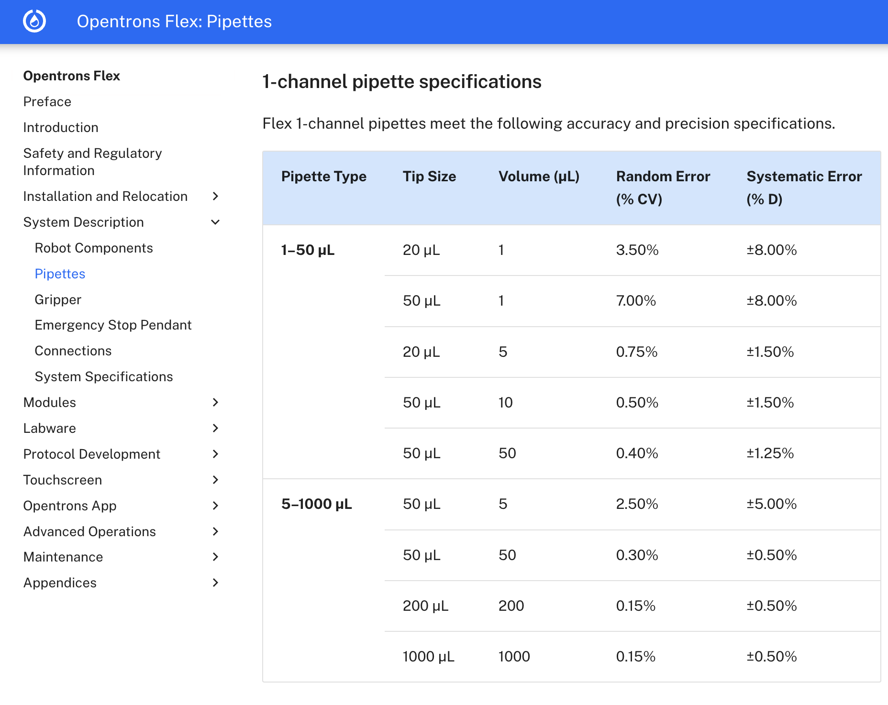

# Mathematical Project

## 1.1 Describe the process

> **Task:**
> Describe the measurement process in plain language: what is physically measured, by
> what instrument, under what conditions, and what is reported. Identify the random
> variables that comprise the process. For each, state what it represents physically
> and what its realizations look like, including units, range, and typical magnitude.
> Hypothesize a statistical distribution for each random variable. Justify your choice.
> Identify at least one derived quantity reported in the literature for this process.
> Write its explicit functional form and name every input.

During optical density (OD) normalization, the Opentrons flex liquid handler dispenses
liquids with variable accuracy and precision errors. At the benchtop and at
low-throughput these errors can easily be accounted for, but at high-throughput in
automation, these small errors can cause major issues, such as:

- Increased variability in OD readings, leading to inconsistent results
- Potential for errors in downstream processes relying on normalized OD measurements
- Reagent & pipette tip waste

During normalization, the liquid handler dispenses liquids hundreds of times until the
OD of each well in the plate is normalized to a range of 1.0 +/- 0.02 OD. At the start
of the process, half of the volume of each well in the plate is split into two equal
volumes. There's a main plate which is the "working" plate and then the split plate is
the "stock" plate. On the equipment, we also have a media plate with just the media for
dilution. We dilute the working plate with liquid form the media plate, and use the
stock plate in the event the working plate is overdiluted. The starting concentration of
each well has to be over 1.0 OD. The volume to be dispensed is calculated for each well
using:

$$C_{1}V_{1}=C_{2}V_{2}$$

In theory, this process should be completed in a single round, but the dispensing error
often leads to the need of multiple rounds in order to have the OD achieve the normal
range. The opentrons flex pipette specifications are as follows:

[Opentrons Flex Pipette Documentation](https://docs.opentrons.com/flex/system-description/pipettes/#1-channel-pipette-specifications)

This simulation will use the Opentrons specification for the 20 µL tip at a 1 µL dispense
(random error reported as % CV, systematic error as a +/- bound). This is the row with the
highest error for this tip, and the specification table gives lower errors at larger
dispense volumes. For simplicity, this single worst-case row is applied to every
dispense regardless of its volume, rather than using the row matching each dispense
volume.

Additionally, the pipette tip volume constrains how much volume is dispensed each round.
The starting volume of each well is 200 µL, which results in the initial splitting into
working and starting plate needing 5 dispenses for example.

### Key Assumptions
1. The worst-case error is applied to every  dispense regardless of its volume, rather 
than using the row matching each dispense volume.
2. Plate reader error is assumed to be negligible.

## 1.2 Analytic Propagation of Uncertainty

> **Task:**
> Apply the law of propagation of uncertainty to your derived quantity. State whether
> your input quantities are correlated. If any are, you should include the covariance
> terms. If you claim that the variables are independent you must justify why. Produce
> an uncertainty budget: a table of input quantities, their standard uncertainties,
> sensitivity coefficients, and contributions to the total. Identify the dominant terms.

## 1.3 Monte Carlo propagation

> **Task:**
> Propagate uncertainty through the same function by Monte Carlo sampling of the input
> distributions. Report the number of trials and show a convergence check: plot your
> summary statistic against trial count, or repeat with independent seeds and report the
> spread. Compare quantitatively to your analytic result.

## 1.4 Hypothesis testing

> **Task:**
> Identify a scenario in your measurement context where hypothesis testing would be
> needed. State H0 and H1 in terms of the physical measurand. Identify an appropriate
> test statistic and its distribution. If no standard distribution applies, construct one
> by Monte-Carlo simulation. List the test's assumptions and evaluate whether each holds
> for your data. Where one does not, either choose a different test or state the
> consequence. Apply the test to data. State whether you are using your own lab’s data,
> data from the paper you cited, or simulated data, and describe the sample size and how
> it was obtained. Report and interpret the result. 
