# Mathematical Project

> **Overall Assignment:**
> Identify an important or interesting statistical measurement process in your lab. If
> you are not yet placed in a lab, or your work is primarily theoretical, you may
> instead
> select a published measurement in your field; in that case you must cite the paper and
> work from the data or summary statistics it reports. Adopt the vocabulary of the Guide
> to the Expression of Uncertainty in Measurement (GUM). The quantity you are measuring
> is
> the measurand. Quantities computed from measured inputs are derived quantities. The
> rule
> for computing a derived quantity from data is an estimator. Distinguish error, defined
> as the unknown difference between a measured value and the true value, from
> uncertainty,
> which is defined as the dispersion. The project has three parts. Parts 1 and 2 are
> individual work. Part 3 is a review of a peer's Part 2. Weights: Part 1, 50%. Part 2,
> 30%. Part 3, 20%.

## 1.1 Describe the process

> **Task:**
> Describe the measurement process in plain language: what is physically measured, by
> what instrument, under what conditions, and what is reported. Identify the random
> variables that comprise the process. For each, state what it represents physically
> and what its realizations look like, including units, range, and typical magnitude.
> Hypothesize a statistical distribution for each random variable. Justify your choice.
> Identify at least one derived quantity reported in the literature for this process.
> Write its explicit functional form and name every input.

During optical density (OD) normalization, the Opentrons flex liquid handler dispenses
liquids with variable accuracy and precision errors. At the benchtop and
low-throughput these errors can easily be accounted for, but at high-throughput in
automation, these small errors can cause major issues, such as:

- Increased variability in OD readings across wells, leading to unnormalized OD values
- Potential for errors in downstream processes relying on normalized OD measurements
- Reagent & pipette tip waste

The process uses three plates, shown below. Liquid only moves into the destination
plate;
nothing is ever dispensed back to the source plate.

| Plate             | Contents                    | Role in the process                            |
|-------------------|-----------------------------|------------------------------------------------|
| Source plate      | Starting culture            | Supplies culture to the destination plate      |
| Media plate       | Media only                  | Supplies media to dilute the destination plate |
| Destination plate | Culture, diluted with media | The plate that is normalized to the target OD  |

During normalization, the liquid handler dispenses liquids hundreds of times until the
OD of each well in the destination plate is normalized to a range of 1.0 +/- 0.02 OD. At
the start of the process, half of the volume of each source well is transferred to the
matching destination well. The destination plate is then diluted with media from the
media plate. The starting concentration of each well has to be over 1.0 OD. The volume
of
media to be dispensed is calculated for each well using:

$$C_{1}V_{1}=C_{2}V_{2}$$

In theory, this process should be completed in a single round, but the dispensing error
and volume constraints often leads to the need for multiple rounds until the OD of each
well is within the normal range. The opentrons flex pipette specifications are as
follows:

[Opentrons Flex Pipette Documentation](https://docs.opentrons.com/flex/system-description/pipettes/#1-channel-pipette-specifications)

This simulation will use the Opentrons specification for the 20 µL tip at a 1 µL
dispense (random error reported as % CV, systematic error as a +/- bound). This is the
row with the
highest error for this tip, and the specification table gives lower errors at larger
dispense volumes.

Additionally, the pipette tip volume constrains how much volume is dispensed each round.
The starting volume of each source well is 200 µL, so the initial transfer of half of it
(100 µL) to the destination plate needs 5 dispenses of 20 µL, for example. The graphic
below shows this transfer and how the dispense error accumulates across the 5 dispenses.

### Key Assumptions

1. The worst-case error is applied to every dispense regardless of its volume, rather
   than using the row matching each dispense volume.
2. Plate reader error & dispense error from viscosity is assumed to be negligible.
3. The systematic error (bias) is a property of the pipette: one bias is shared by every
   dispense in a run, for both the transfer and the dilution, whatever the tip or volume.

## 1.2 Analytic Propagation of Uncertainty

> **Task:**
> Apply the law of propagation of uncertainty to your derived quantity. State whether
> your input quantities are correlated. If any are, you should include the covariance
> terms. If you claim that the variables are independent you must justify why. Produce
> an uncertainty budget: a table of input quantities, their standard uncertainties,
> sensitivity coefficients, and contributions to the total. Identify the dominant terms.

For full derivation, see [derivation notes](notes/1-2 Derivation Rewrite.pdf)
For calculations, see [uncertainty spreadsheet][src/1-2_uncertainty-budget.xlsx]
**Measurement model $f$**

| Symbol                                | Meaning                                                                                      |
|---------------------------------------|----------------------------------------------------------------------------------------------|
| Tilde, e.g. $\tilde V$                | Nominal (commanded) volume: the value the robot is told to dispense; exact                   |
| No tilde, e.g. $V$                    | True (delivered) volume: carries the dispense error                                          |
| Subscript $t$                         | Transfer step: culture from the source well into the destination well                        |
| Subscript $d$                         | Dilution step: media into the destination well                                               |
| $j$, $k$                              | Index of a dispense within the transfer step ($j$) or the dilution step ($k$)                |
| $m_t$, $m_d$                          | Number of dispenses in the transfer and dilution steps                                       |
| $\tilde v_j$, $v_j$                   | Nominal and true volume of dispense $j$                                                      |
| $\tilde V_{step}$, $V_{step}$         | Nominal and true total volume of a step, $\tilde V_{step}=\sum_j\tilde v_j$                  |
| $w_j$                                 | Weight of dispense $j$: its share of the step's nominal volume, $\tilde v_j/\tilde V_{step}$ |
| $\varepsilon_{systematic}$            | Systematic dispense error (bias): a fixed fraction shared by every dispense of a step        |
| $\varepsilon_{random,j}$              | Random dispense error of dispense $j$: independent from dispense to dispense                 |
| $\varepsilon_{total}$                 | Fractional volume error of a whole step                                                      |
| $\tilde V_{transfer}$, $V_{transfer}$ | Nominal (100 µL) and true culture volume transferred into the destination well               |
| $\tilde V_d$, $V_d$                   | Nominal and true media volume added                                                          |
| $C_0$                                 | Starting OD of the culture (exact)                                                           |
| $C_{target}$                          | Target OD (1.0)                                                                              |
| $C_{final}$                           | OD of the destination well after the round-1 dilution (the measurand)                        |
| $u(\cdot)$                            | Standard uncertainty: the uncertainty of a quantity as one standard deviation                |
| $u_c(C_{final})$                      | Combined standard uncertainty of $C_{final}$                                                 |
| $c_i$                                 | Sensitivity coefficient of input $x_i$: change in $C_{final}$ per unit change in $x_i$       |
| $c_{t,j}$, $c_{d,k}$                  | Sensitivity coefficients of the random errors $\varepsilon_{random,t,j}$ and $\varepsilon_{random,d,k}$ |
| $c_{sys,t}$, $c_{sys,d}$              | Sensitivity coefficients of the biases $\varepsilon_{systematic,t}$ and $\varepsilon_{systematic,d}$ |
| $r$                                   | Correlation coefficient of the transfer and dilution biases, from $-1$ to $+1$               |

Eq. 1, one dispense $j$:

$$v_j=\tilde v_j\, (1+\varepsilon_{systematic}+\varepsilon_{random,j})$$

Eq. 2, one step
(weights $w_j=\tilde v_j/\tilde V_{step}$, $\tilde V_{step}=\sum_j\tilde v_j$):

$$\varepsilon_{total,t}=\varepsilon_{systematic,t}+\sum_{j=1}^{m_t}w_{t,j}\,\varepsilon_{random,t,j},\qquad
\varepsilon_{total,d}=\varepsilon_{systematic,d}+\sum_{k=1}^{m_d}w_{d,k}\,\varepsilon_{random,d,k}$$

Eq. 3, volumes:

$$\tilde V_d=\tilde V_{transfer}\left (\frac{C_0}{C_{target}}-1\right),\qquad V_{transfer}=\tilde V_{transfer} (1+\varepsilon_{total,t}),\qquad V_d=\tilde V_d (1+\varepsilon_{total,d})$$

Eq. 4, culture mass balance:

$$C_{final}=f (\cdot)=\frac{C_0\,V_{transfer}}{V_{transfer}+V_d}$$

**Sensitivity coefficients** ($c_i=\partial f/\partial x_i$, evaluated at zero error)

| Input quantity $x_i$                 | $c_i$                                    |
|--------------------------------------|------------------------------------------|
| $\varepsilon_{systematic,t}$         | $+C_{target}(1-C_{target}/C_0)$          |
| $\varepsilon_{random,t,j}$           | $+C_{target}(1-C_{target}/C_0)\,w_{t,j}$ |
| $\varepsilon_{systematic,d}$         | $-C_{target}(1-C_{target}/C_0)$          |
| $\varepsilon_{random,d,k}$           | $-C_{target}(1-C_{target}/C_0)\,w_{d,k}$ |

**Uncertainty equation** (law of propagation of uncertainty)

$$u_c^2 (C_{final})=\sum_{j=1}^{m_t}c_{t,j}^2\,u^2 (\varepsilon_{random,t,j})+\sum_{k=1}^{m_d}c_{d,k}^2\,u^2 (\varepsilon_{random,d,k})+c_{sys,t}^2\,u^2 (\varepsilon_{systematic,t})+c_{sys,d}^2\,u^2 (\varepsilon_{systematic,d})+2\,c_{sys,t}\,c_{sys,d}\,r\,u (\varepsilon_{systematic,t})\,u (\varepsilon_{systematic,d})$$

With the coefficients inserted:

$$u_c (C_{final})=C_{target}\left (1-\frac{C_{target}}{C_0}\right)\sqrt{u^2 (\varepsilon_{random})\Bigl (\sum_j w_{t,j}^2+\sum_k w_{d,k}^2\Bigr)+2\, (1-r)\,u^2 (\varepsilon_{systematic})}$$

**Standard uncertainties** (Type B, Opentrons spec, 20 µL tip, 1 µL row)

| Input quantity                         | Spec value or basis              | Conversion                          | Standard uncertainty (fraction of volume) |
|----------------------------------------|----------------------------------|-------------------------------------|-------------------------------------------|
| $\varepsilon_{random}$ (each dispense) | 3.50 % CV                        | A CV is one standard deviation      | $u=0.035$                                 |
| $\varepsilon_{systematic}$ (each step) | ±8.00 % bound                    | Rectangular distribution, $a/\sqrt3$ | $u=0.0462$                                |
| $C_0$                                  | Plate-reader error neglected (assumption 2) | —                        | $u=0$                                     |
| $C_{target}$                           | Setpoint                         | —                                   | $u=0$                                     |
| Nominal volumes $\tilde V$, $\tilde v$  | Commanded values; the delivery error is in $\varepsilon$ | —          | $u=0$                                     |

**Correlation of the input quantities**

| Pair                                                         | Correlated?  | Covariance                                  | Justification                                                         |
|--------------------------------------------------------------|--------------|---------------------------------------------|-----------------------------------------------------------------------|
| $\varepsilon_{random}$ of two different dispenses            | No ($r=0$)   | 0                                           | Each dispense is a separate aspirate-and-dispense cycle, so its scatter does not depend on any other dispense |
| $\varepsilon_{systematic}$ vs $\varepsilon_{random}$         | No ($r=0$)   | 0                                           | Different mechanisms: a fixed offset versus scatter                   |
| $\varepsilon_{systematic,t}$ vs $\varepsilon_{systematic,d}$ | Yes ($r=+1$) | $r\,u^2(\varepsilon_{systematic})=0.002133$ | One pipette bias shared by every dispense of the run (assumption 3) |

**Uncertainty budget** (20 µL tip, $C_0=1.5$, $C_{target}=1.0$; transfer 5 × 20 µL,
dilution 20 + 20 + 10 µL)

| Input Quantity                                                 | Standard Uncertainty | Sensitivity Coefficient (OD) | Signed contribution, $c_i u(x_i)$ (OD) | Term in $u_c^2$ (OD²)        | Share of $u_c^2$ |
|----------------------------------------------------------------|----------------------|------------------------------|------------------------------------------|------------------------------|------------------|
| $\varepsilon_{systematic,t}$                                   | 0.0462               | +0.3333                      | +0.0154                                  | $2.37\times10^{-4}$          | +311.0 %         |
| $\varepsilon_{systematic,d}$                                   | 0.0462               | −0.3333                      | −0.0154                                  | $2.37\times10^{-4}$          | +311.0 %         |
| Covariance of the bias pair ($r=+1$)                           |                      |                              |                                          | $-4.74\times10^{-4}$         | −622.0 %         |
| $\varepsilon_{random,t,1}$ to $\varepsilon_{random,t,5}$       | 0.035 each           | +0.0667 each                 | +0.0023 each                             | $2.72\times10^{-5}$ total    | 35.7 %           |
| $\varepsilon_{random,d,1}$, $\varepsilon_{random,d,2}$ (20 µL) | 0.035 each           | −0.1333 each                 | −0.0047 each                             | $4.36\times10^{-5}$ total    | 57.1 %           |
| $\varepsilon_{random,d,3}$ (10 µL)                             | 0.035                | −0.0667                      | −0.0023                                  | $5.44\times10^{-6}$          | 7.1 %            |
| $C_0$, $C_{target}$, nominal volumes                           | 0                    |                              | 0                                        | 0                            | 0 %              |
| **Total**                                                      |                      |                              |                                          | $\mathbf{7.62\times10^{-5}}$ | 100 %            |
| **$u_c(C_{final})$**                                           |                      |                              |                                          | **0.0087 OD**                |                  |

**Dominant terms** (at $r=+1$)

| Group                                | Share of $u_c^2$ |
|--------------------------------------|------------------|
| Dilution random errors (3 dispenses) | 64.3 %           |
| Transfer random errors (5 dispenses) | 35.7 %           |
| Biases, net of the covariance term   | 0 %              |

**Sensitivity to the bias correlation** ($C_0=1.5$, 20 µL tip)

| $r$ between the two biases | $u_c$ (OD) | Share of $u_c^2$ from the biases (net) |
|----------------------------|------------|----------------------------------------|
| 1.0                        | 0.0087     | 0 %                                    |
| 0.9                        | 0.0111     | 38 %                                   |
| 0.5                        | 0.0177     | 76 %                                   |
| 0.0                        | 0.0235     | 86 %                                   |

**Budget across the starting-OD range** (same assumptions, 20 µL tip)

| $C_0$ | Dilution dispenses | $C_{target}(1-C_{target}/C_0)$ | $u_c$ (OD) |
|-------|--------------------|--------------------------------|------------|
| 1.2   | 20                 | 0.167                          | 0.0064     |
| 1.5   | 20, 20, 10         | 0.333                          | 0.0087     |
| 1.8   | 20, 20, 20, 20     | 0.444                          | 0.0104     |

## 1.3 Monte Carlo propagation

> **Task:**
> Propagate uncertainty through the same function by Monte Carlo sampling of the input
> distributions. Report the number of trials and show a convergence check: plot your
> summary statistic against trial count, or repeat with independent seeds and report the
> spread. Compare quantitatively to your analytic result.

Notebook: `src/OD_Norm-MonteCarlo.ipynb`.

**Method** (JCGM 101). Each trial draws every input from its 1.2 distribution and pushes the draws
through the exact model $f$ (layers 1–4 of 1.2, no linearization). The standard deviation of
$C_{final}$ over the trials is the Monte Carlo $u_c$. Same scenario as the 1.2 budget: 20 µL tip,
$C_0=1.5$, $C_{target}=1.0$, transfer 5 × 20 µL, dilution 20 + 20 + 10 µL.

| Input                    | Distribution                                       | Draws per trial                                         |
|--------------------------|----------------------------------------------------|---------------------------------------------------------|
| $\varepsilon_{systematic}$ | Uniform$(-0.08, +0.08)$, $u=0.0462$              | 1, shared by the transfer and the dilution (assumption 3) |
| $\varepsilon_{random}$     | Normal$(0, 0.035)$                               | 1 per dispense: 5 transfer, 3 dilution                  |

**Number of trials**: $N = 100{,}000$.

**Comparison with the analytic result**

| Quantity                          | Monte Carlo | Analytic (1.2)               |
|-----------------------------------|-------------|------------------------------|
| Mean of $C_{final}$ (OD)          | 0.99998     | 1.0                          |
| $u_c(C_{final})$ (OD)             | 0.00877     | 0.00873                      |
| $P(\lvert C_{final}-1\rvert>0.02)$ | 0.0230      | 0.022 (normal with analytic $u_c$) |

- Ratio Monte Carlo / analytic $u_c$ = 1.004.
- Monte Carlo standard error of the standard deviation: $u_c/\sqrt{2N} = 2.0\times10^{-5}$ OD (0.22 %).
- The +0.4 % difference is about 2 standard errors. It is expected: the analytic budget is first order
  and drops the second-order terms (bias × random error) that the exact model keeps, worth about
  +0.35 % (notes, `UncertaintyBudget-Summary.md` section 6). Averaged over 60 seeds the ratio is 1.003.

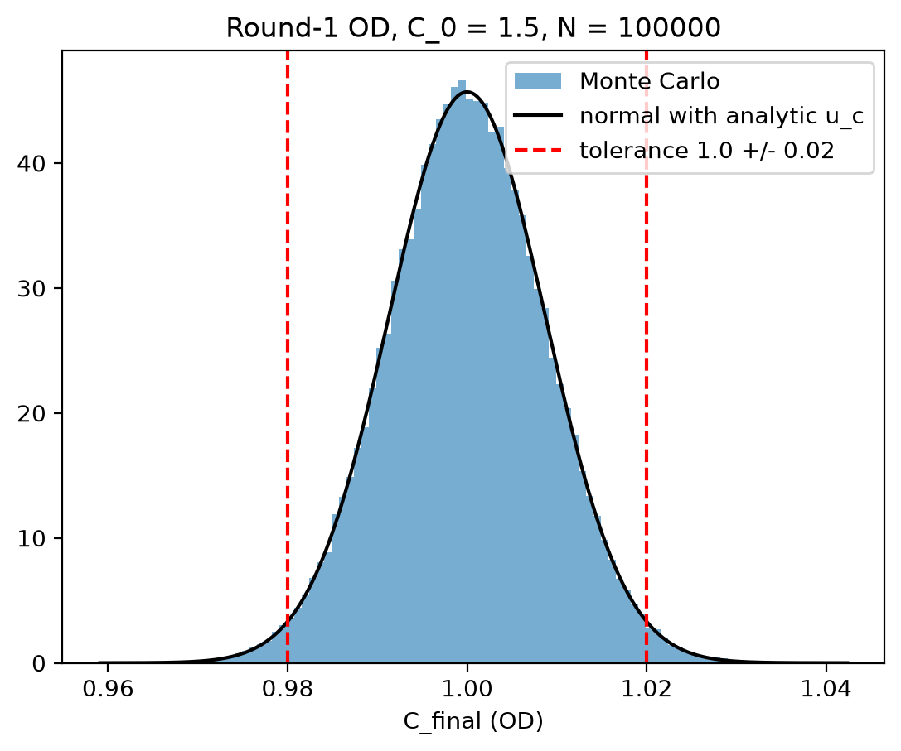

**Convergence check**

- From about 3,000 trials on, the running standard deviation stays within 1.2 % of the analytic
  $u_c$, and within 0.6 % from 20,000 trials on.
- 5 independent seeds give $u_c$ = 0.008766 to 0.008781 OD (mean 0.008770 OD).

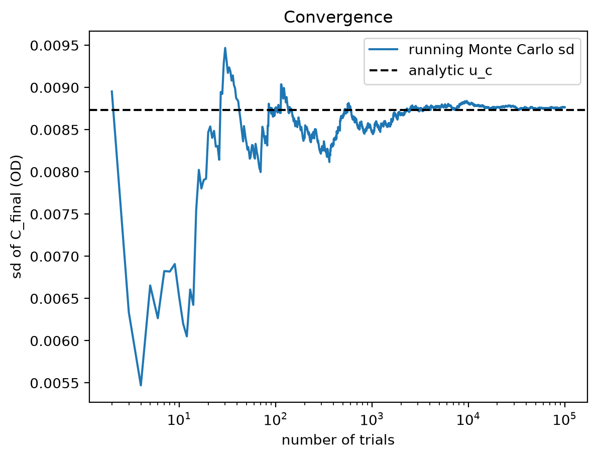

**Across the plate** (96 wells, $C_0$ from 1.05 to 1.8, one bias per plate run, 5000 runs)

- The Monte Carlo standard deviation matches the analytic $u_c$ of every well within 2.6 % (the
  Monte Carlo standard error per well is about 1 % at 5000 runs).
- Expected wells outside 1.0 ± 0.02 OD after round 1: 1.8 of 96.

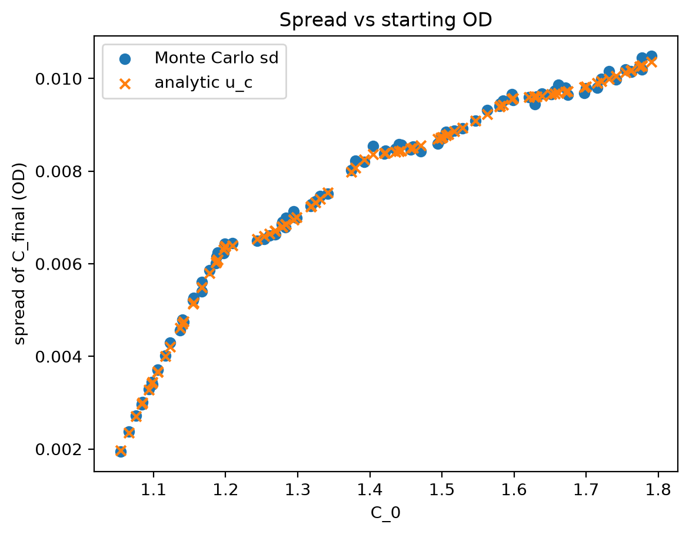

## 1.4 Hypothesis testing

> **Task:**
> Identify a scenario in your measurement context where hypothesis testing would be
> needed. State H0 and H1 in terms of the physical measurand. Identify an appropriate
> test statistic and its distribution. If no standard distribution applies, construct
> one
> by Monte-Carlo simulation. List the test's assumptions and evaluate whether each holds
> for your data. Where one does not, either choose a different test or state the
> consequence. Apply the test to data. State whether you are using your own lab’s data,
> data from the paper you cited, or simulated data, and describe the sample size and how
> it was obtained. Report and interpret the result.

Notebook: `src/OD_Norm-TipComparison.ipynb`.

**Scenario.** The Flex 1–50 µL pipette can run with a 20 µL or a 50 µL tip. The 50 µL tip needs
fewer dispenses (the 100 µL transfer is 2 × 50 µL instead of 5 × 20 µL) but has larger spec errors
at the worst-case row (assumption 1): 7.0 % CV against 3.5 %, both ±8 %. Does the tip change how
far the wells land from the target?

**Measurand.** The OD error of each well after round 1, $e = C_{final} - C_{target}$ (OD).

**Hypotheses** ($\sigma^2$ = variance of $e$ over the plate)

- $H_0$: $\sigma_{50}^2 = \sigma_{20}^2$, the OD error has the same variance with either tip
- $H_1$: $\sigma_{50}^2 \neq \sigma_{20}^2$

The test is on the variance, not the mean: the shared bias cancels (1.2), so both mean errors are
about 0 (observed −0.0007 and +0.0003 OD).

**Test statistic and distribution.** Levene's test, a one-way ANOVA on the absolute deviations
$z_{ij} = \lvert e_{ij} - \bar e_i\rvert$ (tip $i$, well $j$):

$$W = \frac{(N - k)\sum_i n\,(\bar z_i - \bar z)^2}{(k - 1)\sum_i \sum_j (z_{ij} - \bar z_i)^2} \sim F(k-1,\,N-k) = F(1,\,190) \text{ under } H_0$$

with $k=2$ tips, $n=96$ wells per tip, $N=192$. A standard distribution applies, so no Monte Carlo
construction is needed. Reject $H_0$ at $\alpha=0.05$ if $W > F_{0.95}(1,190) = 3.89$.

**Assumptions**

| Assumption                                 | Holds?                                                                                       |
|--------------------------------------------|----------------------------------------------------------------------------------------------|
| Observations independent within each tip   | Approximately: the wells of one plate share one pipette bias, which cancels at first order   |
| Observations independent between the tips  | Yes: each plate is a separate run with its own bias and random errors; only $C_0$ is shared |

- Normality is not required; Levene's test is robust to it. This is why it is used instead of the
  variance-ratio F test, which is sensitive to non-normal data.
- The wells of one tip do not share one variance (the spread grows with $C_0$, 1.3). Consequence:
  $\sigma^2$ is the variance over this plate's mix of starting ODs. Both tips use the same mix, so the
  comparison is like for like.

**Data.** Simulated with the 1.3 model (`normalize_plate` in `src/od_norm.py`): one 96-well plate per
tip, the same starting ODs for both ($C_0$ drawn uniformly from 1.05 to 1.8, seed 42), one plate run
each. $n = 96$ per tip.

**Results & Discussion**

| Quantity                          | 20 µL tip | 50 µL tip |
|-----------------------------------|-----------|-----------|
| Standard deviation of $e$ (OD)    | 0.00635   | 0.02225   |
| Wells outside 1.0 ± 0.02 OD       | 0 of 96   | 36 of 96  |

$W(1, 190) = 69.0$, $p = 1.8\times10^{-14}$: reject $H_0$.

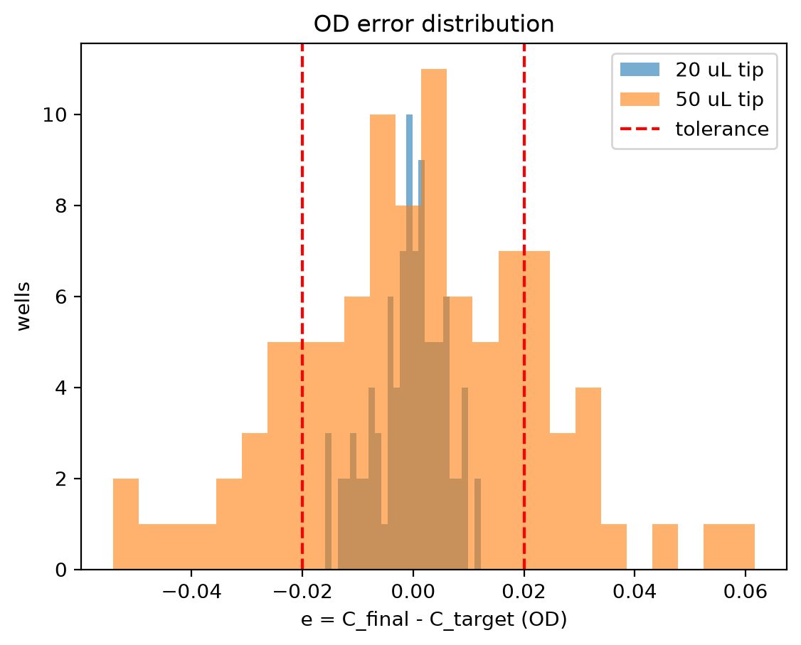

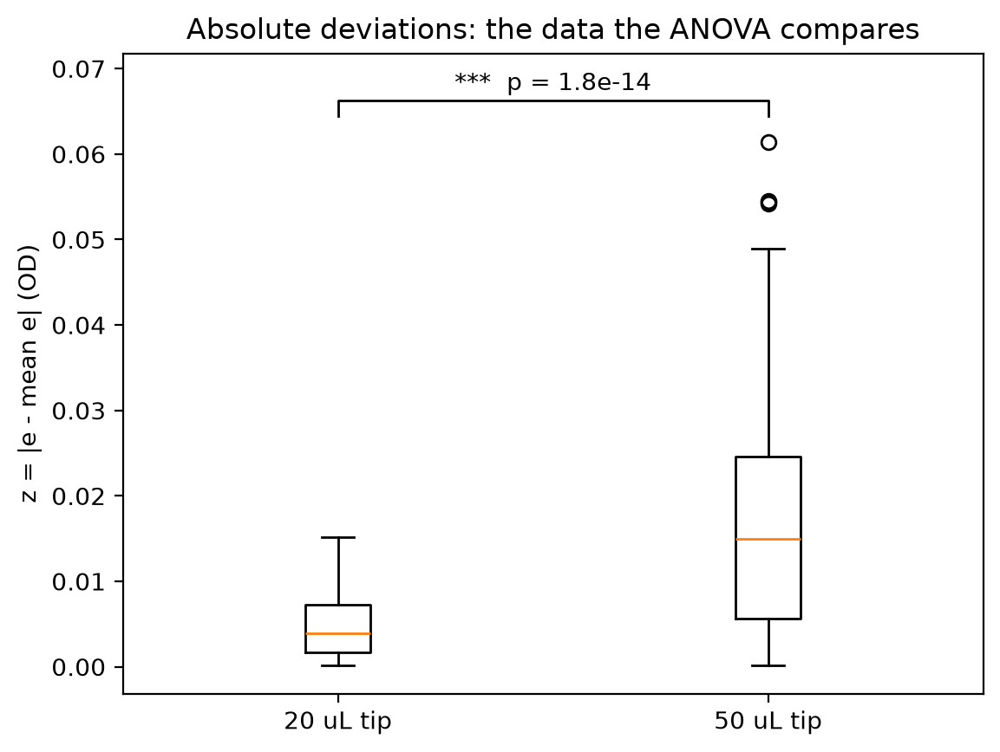

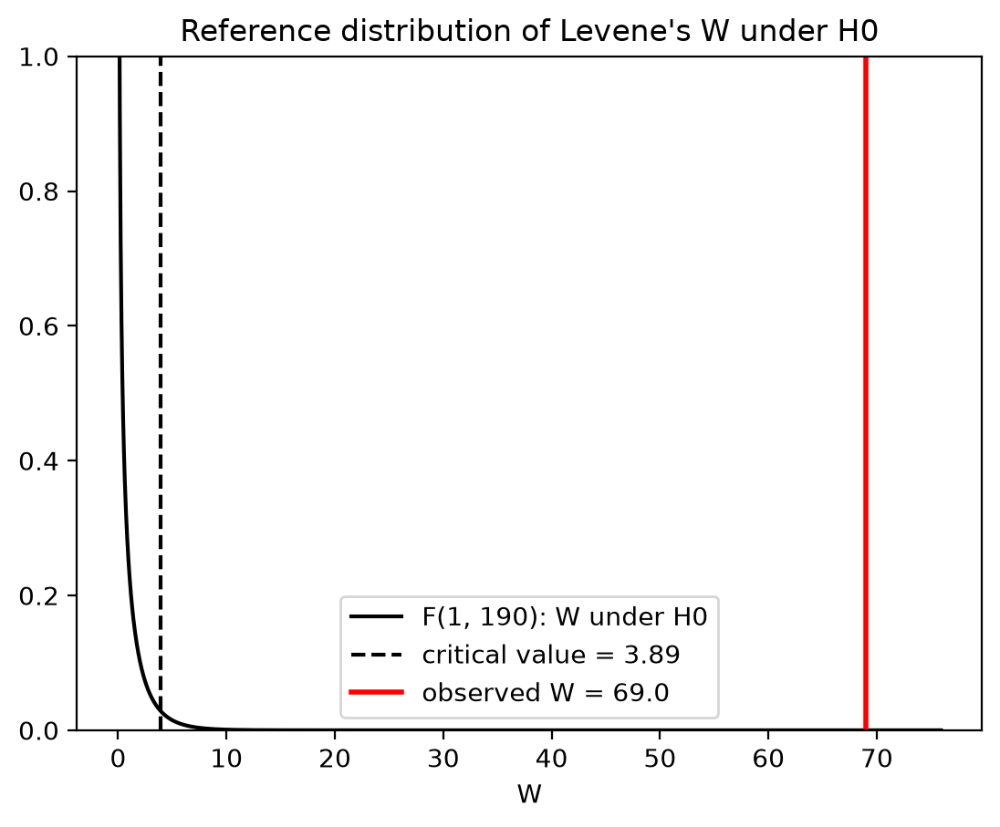

- The variance of the OD error differs between the tips. The 50 µL tip's standard deviation is 3.5
  times the 20 µL tip's in this run (about 3.0 expected from the analytic $u_c$ of each well), and it
  leaves 36 of 96 wells out of tolerance against none. For round 1, the 20 µL tip is the better choice.
- Both differences between the tips push the same way: the CV doubles (× 2), and fewer, larger
  dispenses average out less random error (about × 1.5 over the plate).
- The result holds only under assumption 1. At the rows matching the dispense volumes, the 50 µL tip's
  CV (0.4 %) is lower than the 20 µL tip's (0.75 %), so the difference would shrink or reverse.

## Supplementary figures

### 1.3 Monte Carlo propagation

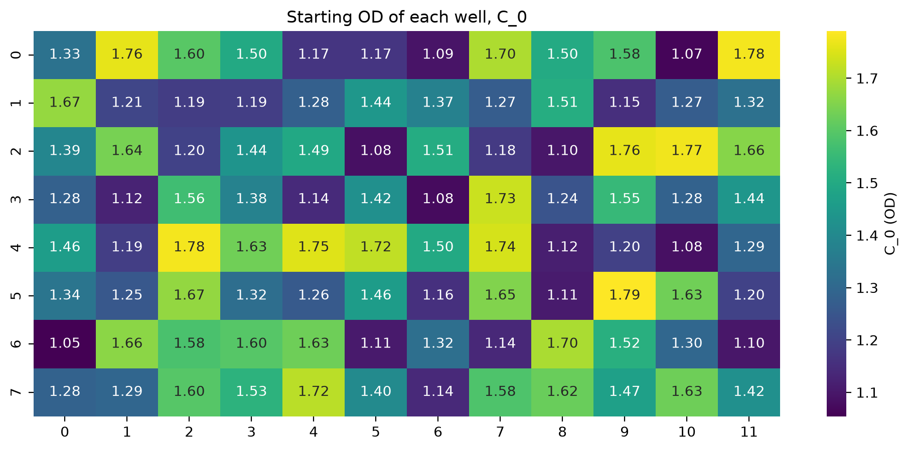

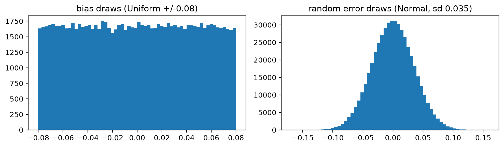

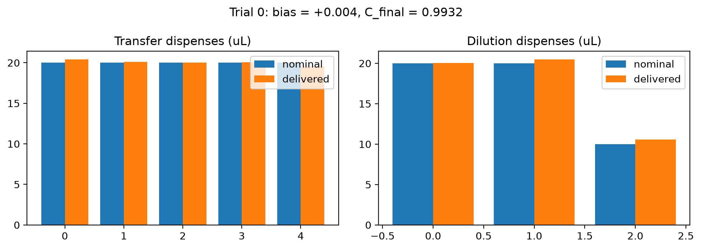

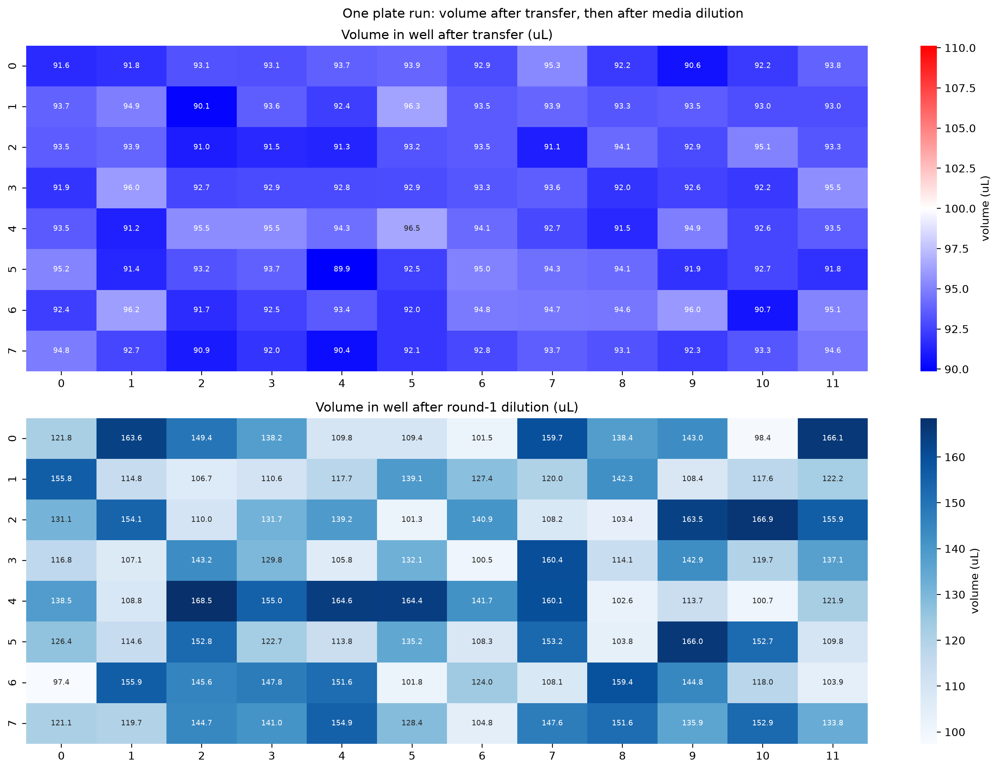

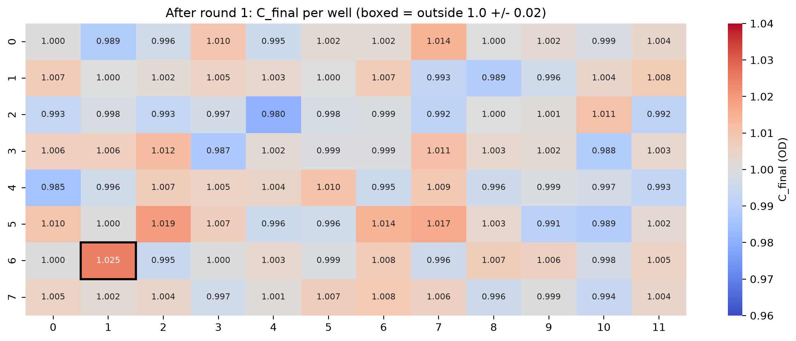

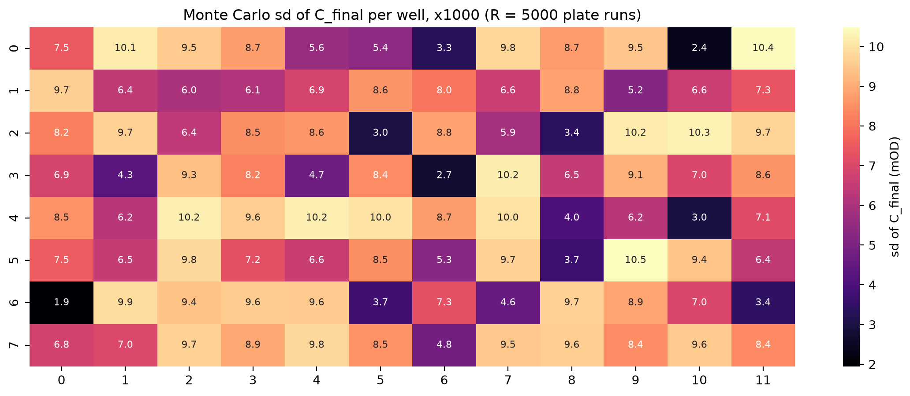

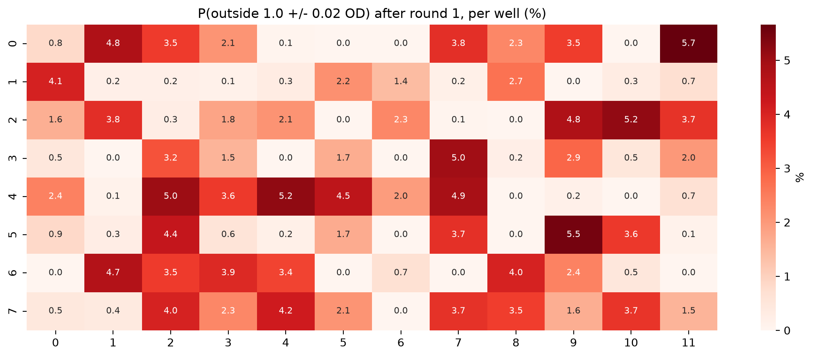

### 1.4 Hypothesis testing

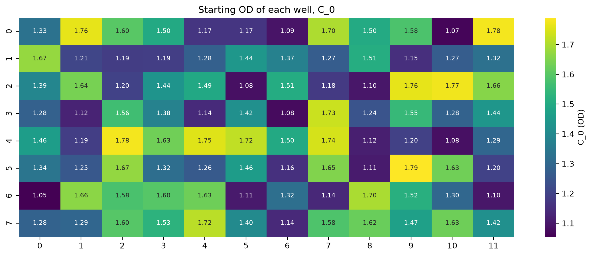

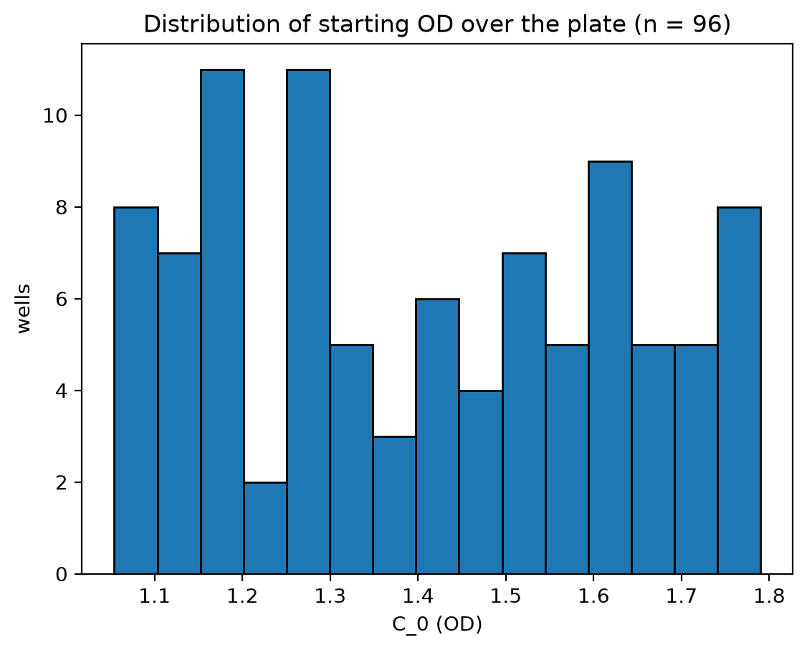

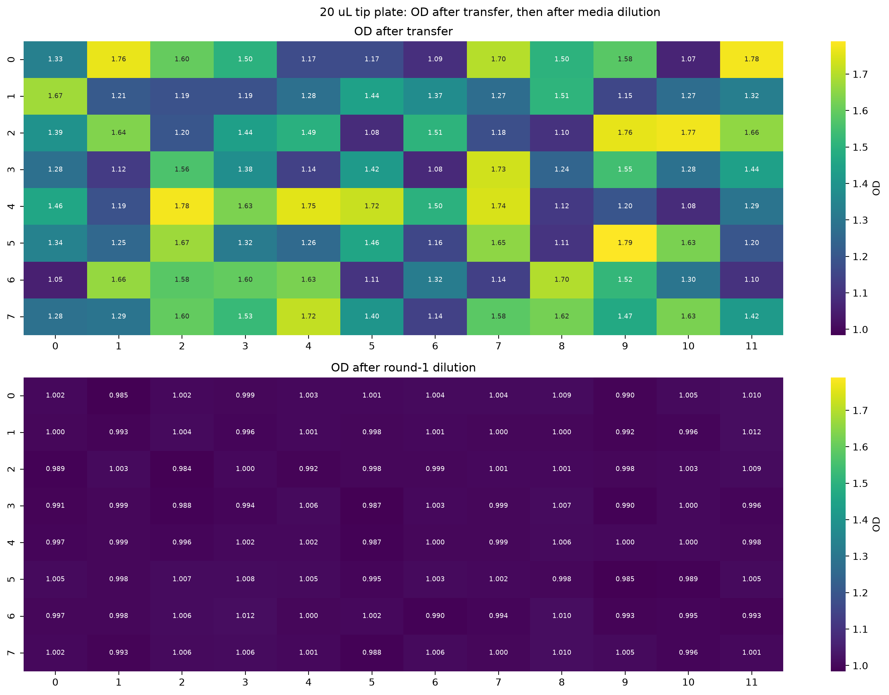

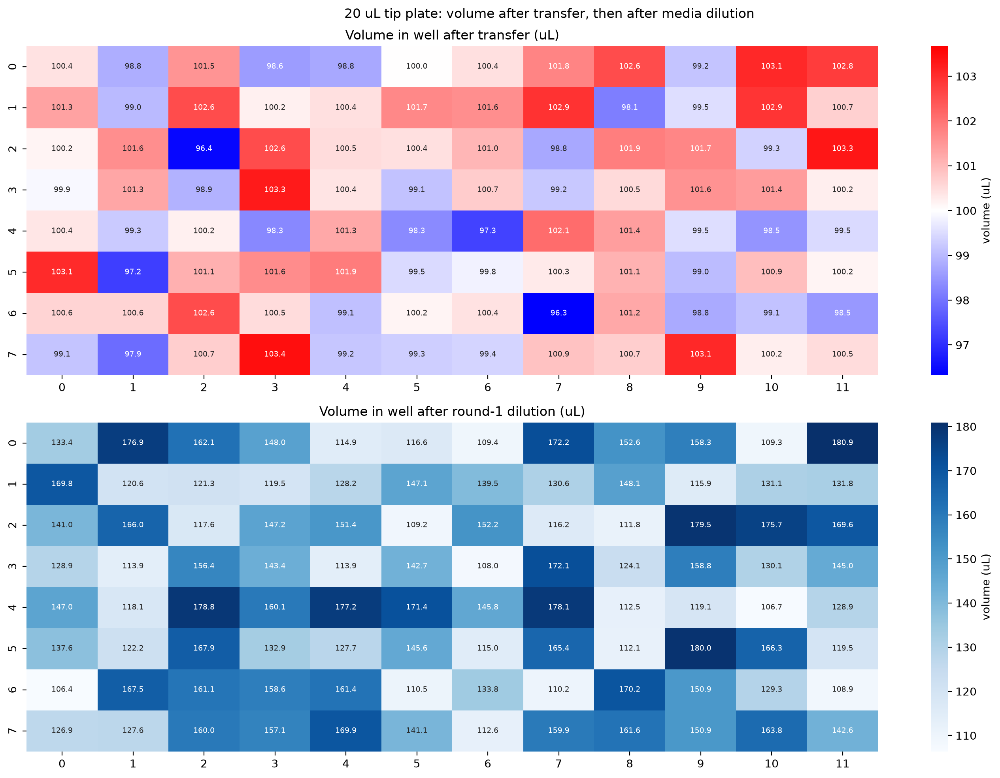

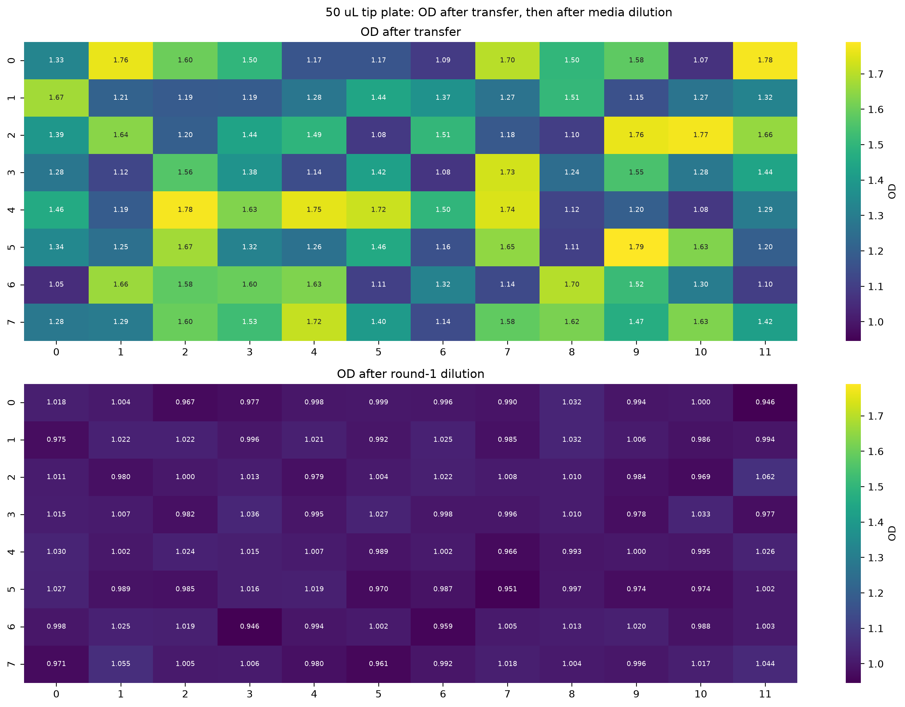

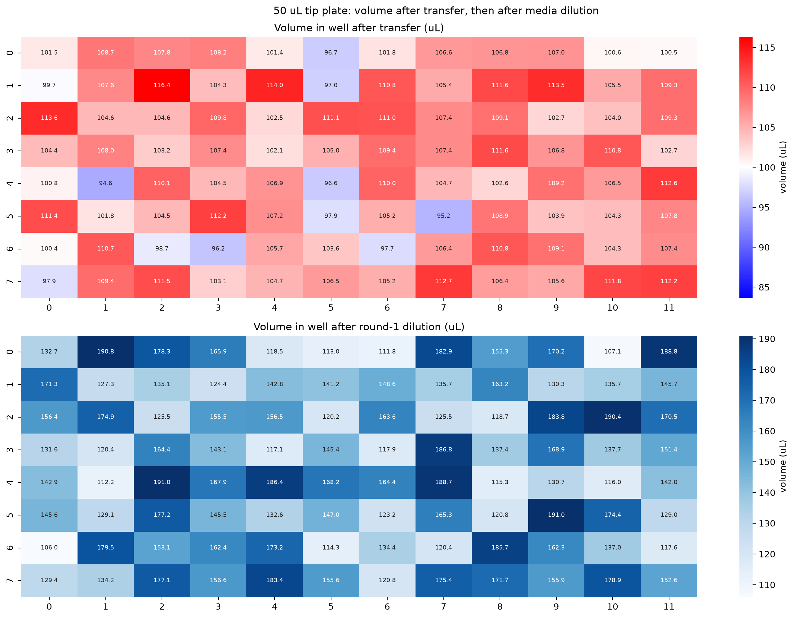

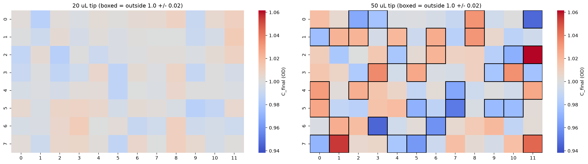
