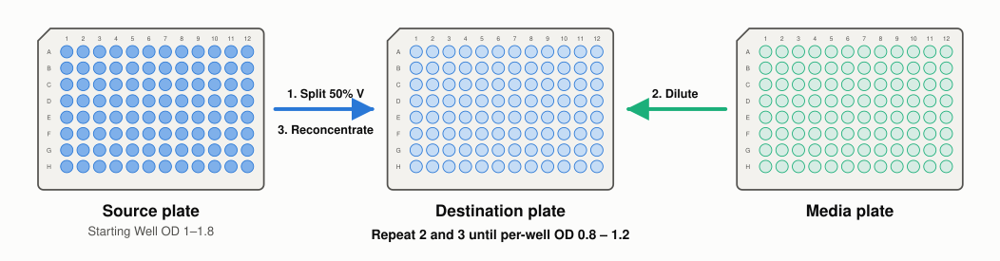
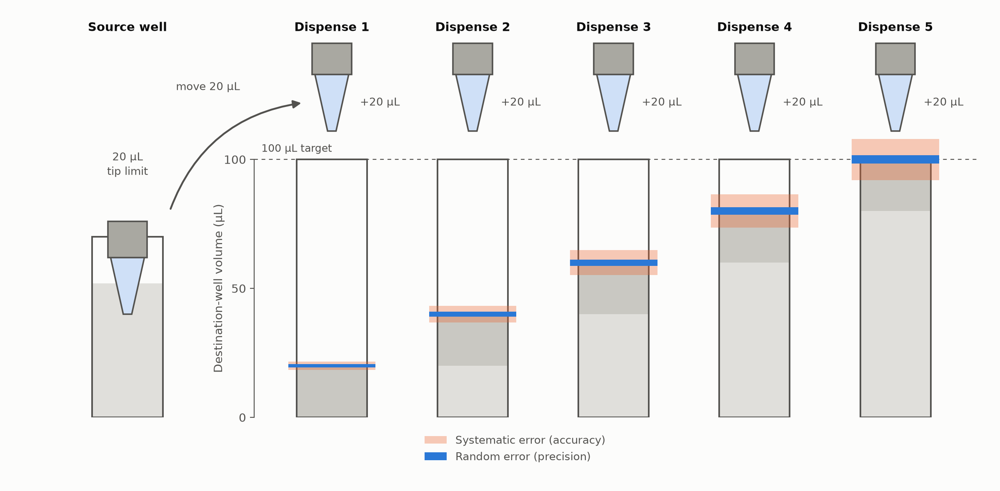

# Mathematical Project

> **Overall Assignment:**
> Identify an important or interesting statistical measurement process in your lab. If
> you are not yet placed in a lab, or your work is primarily theoretical, you may instead
> select a published measurement in your field; in that case you must cite the paper and
> work from the data or summary statistics it reports. Adopt the vocabulary of the Guide
> to the Expression of Uncertainty in Measurement (GUM). The quantity you are measuring is
> the measurand. Quantities computed from measured inputs are derived quantities. The rule
> for computing a derived quantity from data is an estimator. Distinguish error, defined
> as the unknown difference between a measured value and the true value, from uncertainty,
> which is defined as the dispersion. The project has three parts. Parts 1 and 2 are
> individual work. Part 3 is a review of a peer's Part 2. Weights: Part 1, 50%. Part 2,
> 30%. Part 3, 20%.

## 1.1 Describe the process

> **Task:**
> Describe the measurement process in plain language: what is physically measured, by
> what instrument, under what conditions, and what is reported. Identify the random
> variables that comprise the process. For each, state what it represents physically
> and what its realizations look like, including units, range, and typical magnitude.
> Hypothesize a statistical distribution for each random variable. Justify your choice.
> Identify at least one derived quantity reported in the literature for this process.
> Write its explicit functional form and name every input.

During optical density (OD) normalization, the Opentrons flex liquid handler dispenses
liquids with variable accuracy and precision errors. At the benchtop and
low-throughput these errors can easily be accounted for, but at high-throughput in
automation, these small errors can cause major issues, such as:

- Increased variability in OD readings across wells, leading to unnormalized OD values
- Potential for errors in downstream processes relying on normalized OD measurements
- Reagent & pipette tip waste

The process uses three plates, shown below. Liquid only moves into the destination
plate;
nothing is ever dispensed back to the source plate.

| Plate             | Contents                    | Role in the process                            |
|-------------------|-----------------------------|------------------------------------------------|
| Source plate      | Starting culture            | Supplies culture to the destination plate      |
| Media plate       | Media only                  | Supplies media to dilute the destination plate |
| Destination plate | Culture, diluted with media | The plate that is normalized to the target OD  |

During normalization, the liquid handler dispenses liquids hundreds of times until the
OD of each well in the destination plate is normalized to a range of 1.0 +/- 0.02 OD. At
the start of the process, half of the volume of each source well is transferred to the
matching destination well. The destination plate is then diluted with media from the
media plate. The starting concentration of each well has to be over 1.0 OD. The volume
of
media to be dispensed is calculated for each well using:

$$C_{1}V_{1}=C_{2}V_{2}$$

In theory, this process should be completed in a single round, but the dispensing error
and volume constraints often leads to the need for multiple rounds until the OD of each
well is within the normal range. The opentrons flex pipette specifications are as
follows:

[Opentrons Flex Pipette Documentation](https://docs.opentrons.com/flex/system-description/pipettes/#1-channel-pipette-specifications)

This simulation will use the Opentrons specification for the 20 µL tip at a 1 µL
dispense (random error reported as % CV, systematic error as a +/- bound). This is the
row with the
highest error for this tip, and the specification table gives lower errors at larger
dispense volumes.

Additionally, the pipette tip volume constrains how much volume is dispensed each round.
The starting volume of each source well is 200 µL, so the initial transfer of half of it
(100 µL) to the destination plate needs 5 dispenses of 20 µL, for example. The graphic
below shows this transfer and how the dispense error accumulates across the 5 dispenses.

### Key Assumptions

1. The worst-case error is applied to every dispense regardless of its volume, rather
   than using the row matching each dispense volume.
2. Plate reader error & dispense error from viscosity is assumed to be negligible.

## 1.2 Analytic Propagation of Uncertainty

> **Task:**
> Apply the law of propagation of uncertainty to your derived quantity. State whether
> your input quantities are correlated. If any are, you should include the covariance
> terms. If you claim that the variables are independent you must justify why. Produce
> an uncertainty budget: a table of input quantities, their standard uncertainties,
> sensitivity coefficients, and contributions to the total. Identify the dominant terms.

| Input Quantity | Standard Uncertainty | Sensitivity Coefficient | Contribution to Total |
|----------------|----------------------|-------------------------|-----------------------|
| Volume         |                      |                         |                       |
| Dispense Error |                      |                         |                       |

## 1.3 Monte Carlo propagation

> **Task:**
> Propagate uncertainty through the same function by Monte Carlo sampling of the input
> distributions. Report the number of trials and show a convergence check: plot your
> summary statistic against trial count, or repeat with independent seeds and report the
> spread. Compare quantitatively to your analytic result.

## 1.4 Hypothesis testing

> **Task:**
> Identify a scenario in your measurement context where hypothesis testing would be
> needed. State H0 and H1 in terms of the physical measurand. Identify an appropriate
> test statistic and its distribution. If no standard distribution applies, construct
> one
> by Monte-Carlo simulation. List the test's assumptions and evaluate whether each holds
> for your data. Where one does not, either choose a different test or state the
> consequence. Apply the test to data. State whether you are using your own lab’s data,
> data from the paper you cited, or simulated data, and describe the sample size and how
> it was obtained. Report and interpret the result. 
